# PAKU — PencAtat Keuangan kamU

Aplikasi Android untuk mencatat arus kas (pemasukan & pengeluaran) dengan diagram
lingkaran dan diagram batang yang interaktif. Dibuat dengan Kotlin dan Jetpack
Compose, sepenuhnya offline, tanpa akun, dan tersedia dalam **bahasa Indonesia
dan Inggris**.


## Tangkapan layar

| Beranda | Statistik | Statistik — pilih kategori |
| --- | --- | --- |
| 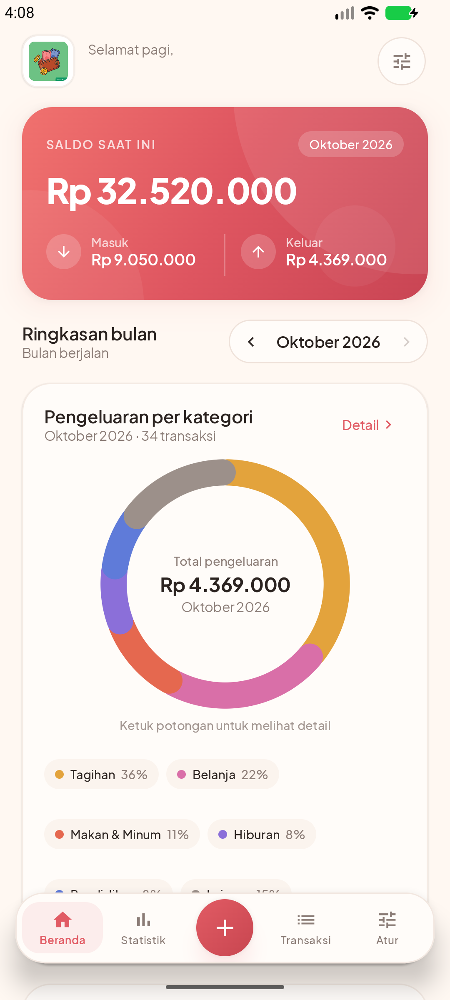 | 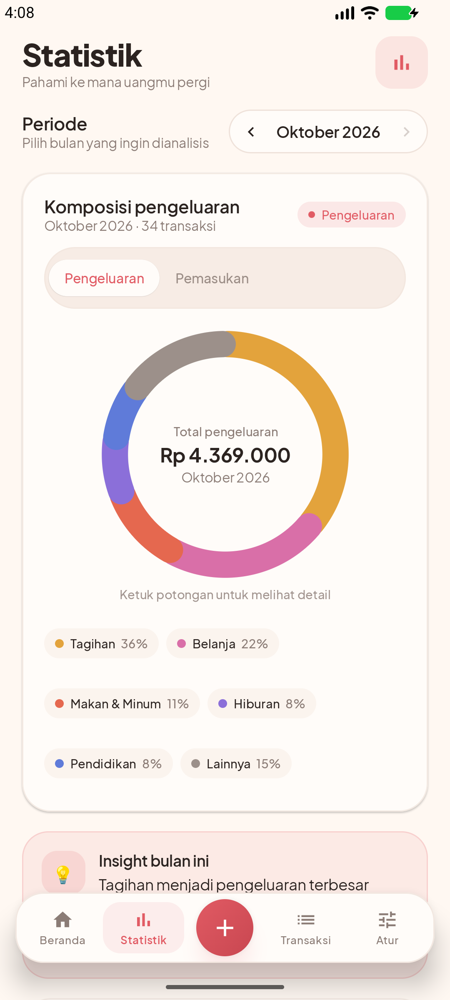 | 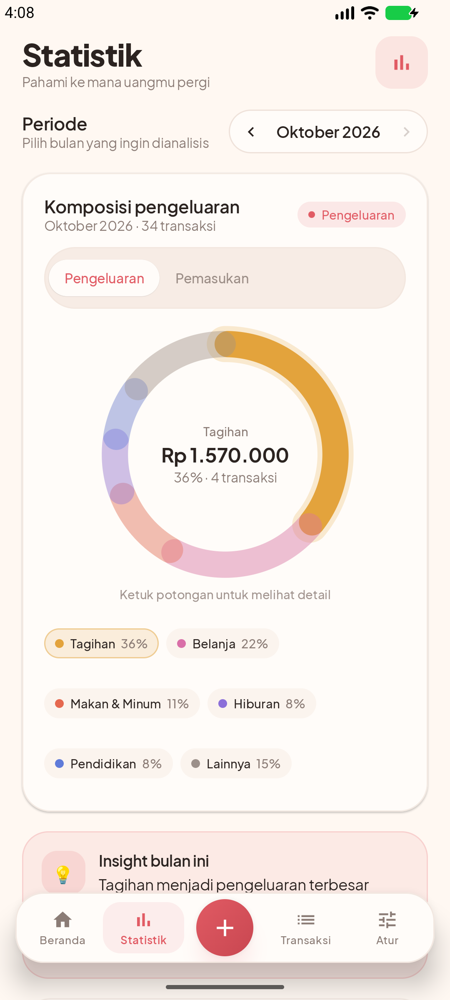 |

| Grafik arus kas 6 bulan | Riwayat transaksi | Catat transaksi |
| --- | --- | --- |
| 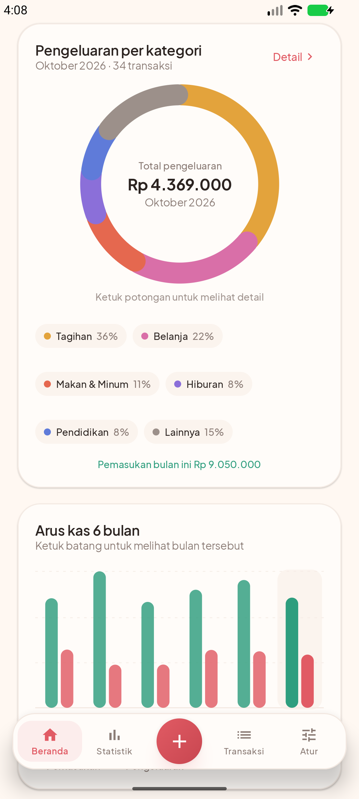 | 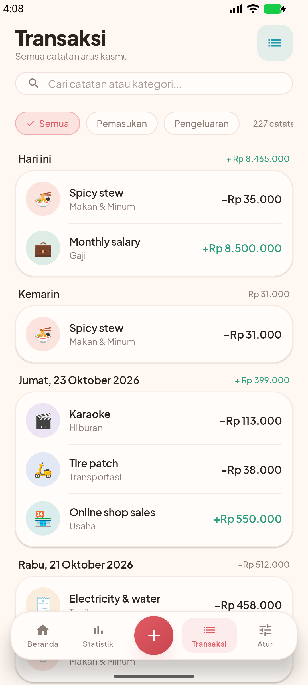 | 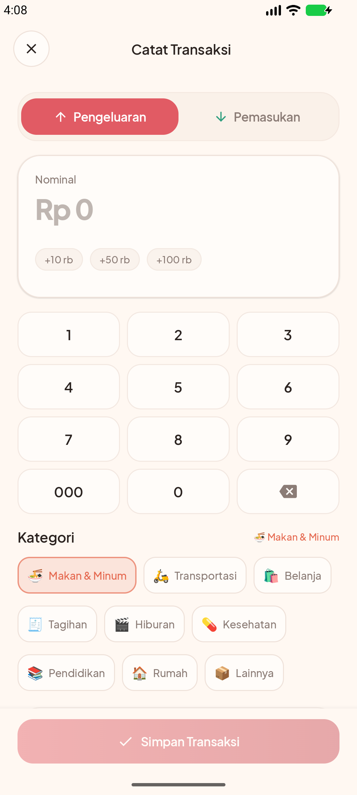 |

| Pengaturan | Mulai pertama kali | |
| --- | --- | --- |
|  | 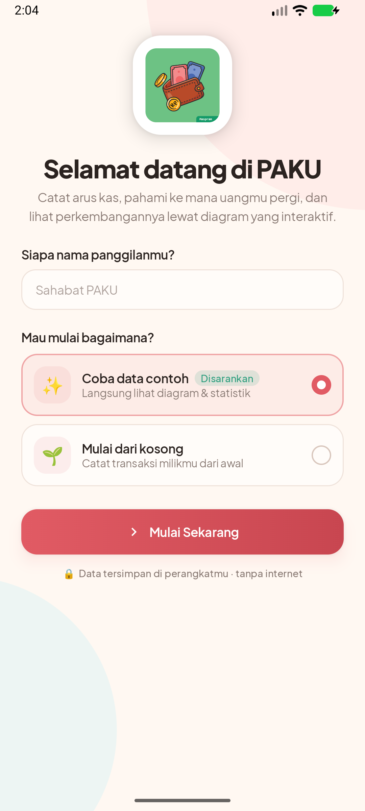 | |

| Pilih bahasa | Tentang aplikasi & pengembang | |
| --- | --- | --- |
| 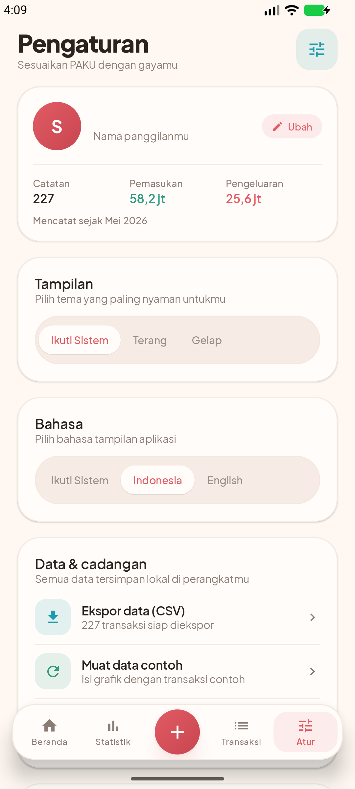 | 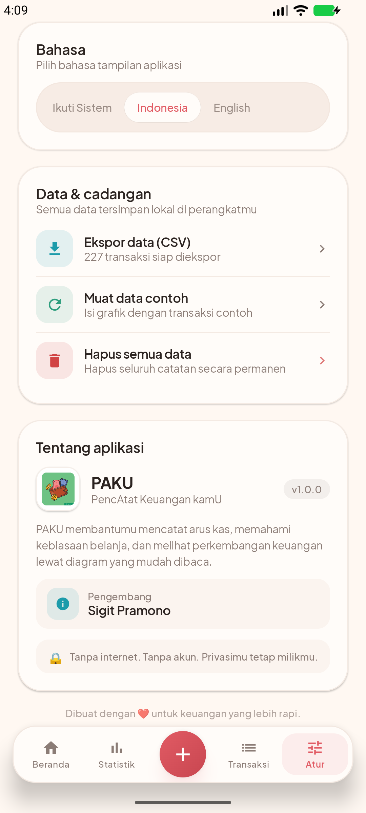 | |

### English

| Home | Statistics | Statistics — category |
| --- | --- | --- |
| 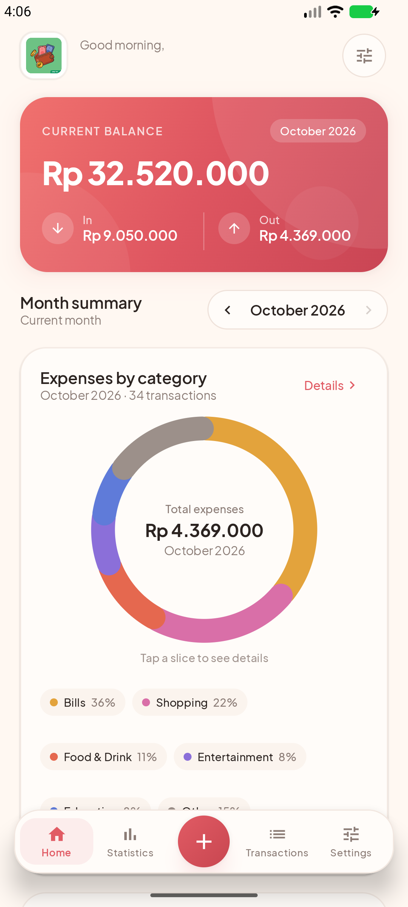 | 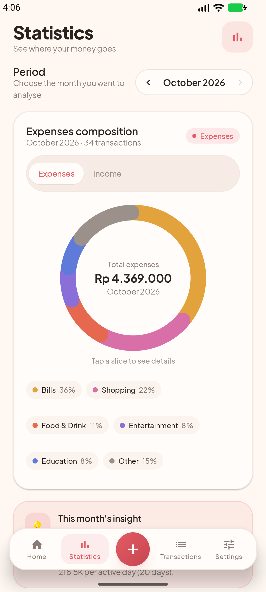 | 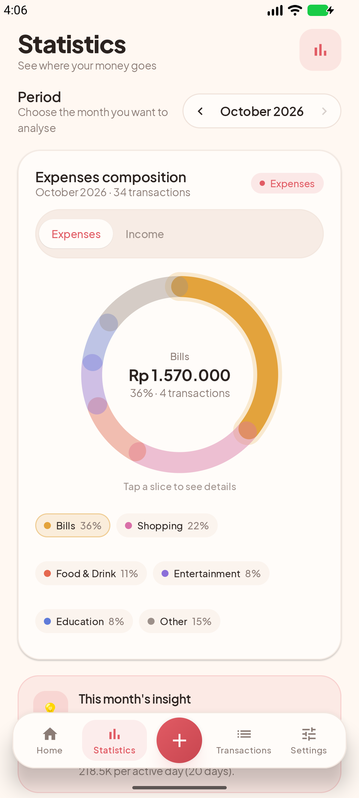 |

| 6-month cash flow | Transactions | Add transaction |
| --- | --- | --- |
| 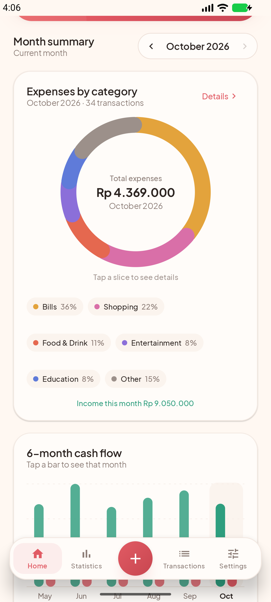 |  | 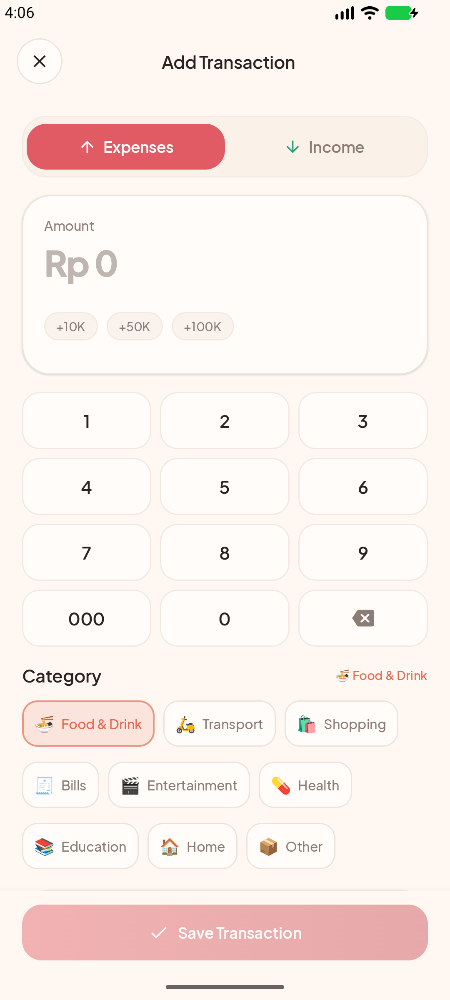 |

| Settings | Language | About |
| --- | --- | --- |
| 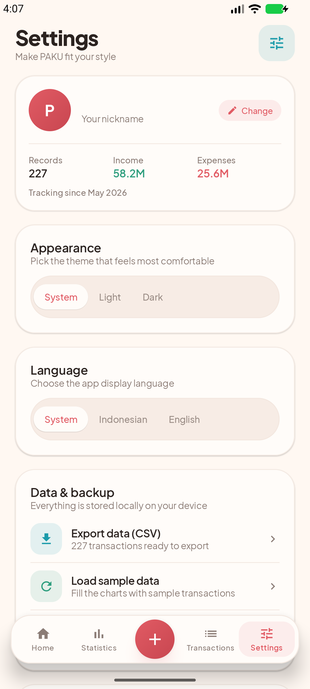 |  | 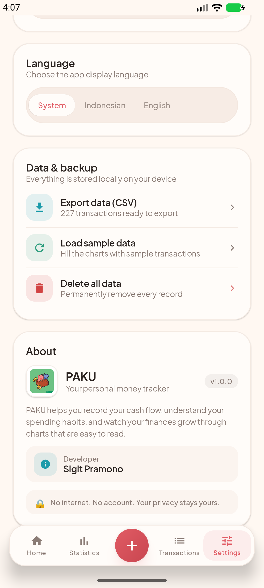 |

| Welcome | | |
| --- | --- | --- |
| 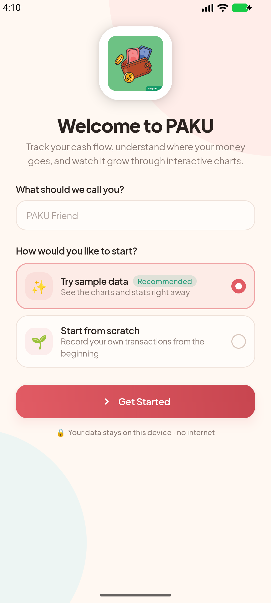 | | |

## Fitur

- **Beranda interaktif** — saldo total, ringkasan pemasukan/pengeluaran bulan ini,
  diagram donat pengeluaran per kategori, serta diagram batang arus kas enam bulan.
- **Diagram interaktif** — ketuk potongan donat atau legenda untuk melihat nominal,
  persentase, dan jumlah transaksi kategori tersebut. Ketuk batang bulan untuk
  berpindah periode dan memperbarui seluruh ringkasan.
- **Catat cepat** — keypad angka khusus, nominal Rupiah otomatis berformat,
  pilihan kategori beremoji, pemilih tanggal, dan catatan singkat.
- **Riwayat transaksi** — pencarian, filter pemasukan/pengeluaran, filter kategori
  dari halaman statistik, pengelompokan per hari, geser untuk menghapus dengan
  opsi **Urungkan**.
- **Statistik** — komposisi pemasukan/pengeluaran, tren enam bulan (keduanya,
  masuk saja, atau keluar saja), insight otomatis, dan rincian per kategori.
- **Dua bahasa** — seluruh antarmuka tersedia dalam bahasa Indonesia dan Inggris,
  mengikuti bahasa sistem atau dipilih manual di **Pengaturan → Bahasa**. Nama
  bulan, sapaan, dan satuan ringkas ikut menyesuaikan.
- **Personal** — nama panggilan, tema Sistem/Terang/Gelap, data contoh sekali klik,
  ekspor CSV, dan hapus data.
- **Tentang aplikasi** — informasi versi dan kredit pengembang **Sigit Pramono**.
- **Tanpa internet** — seluruh data disimpan lokal memakai SharedPreferences + JSON.
- **Onboarding** — pilih mulai dengan data contoh atau dari kosong.
- **Adaptif** — mendukung mode gelap, edge-to-edge, dan animasi halus.

## Teknologi

| Komponen | Versi |
| --- | --- |
| Kotlin | 2.2.10 (built-in Kotlin AGP) |
| Android Gradle Plugin | 9.4.1 |
| Gradle | 9.6.0 |
| Jetpack Compose BOM | 2026.02.01 (Material 3) |
| Min SDK | 26 (Android 8.0) |
| Target / Compile SDK | 37 |
| Java | 17 |

Library tambahan hanya AndroidX (Compose, Activity, Lifecycle, Core). Diagram
digambar sendiri dengan `Canvas` sehingga ringan dan bebas dependensi grafik
pihak ketiga. Font **Plus Jakarta Sans** (lisensi OFL, lihat `licenses/`).

## Menjalankan

### Android Studio

1. Buka folder proyek ini di Android Studio.
2. Tunggu Gradle Sync selesai.
3. Pilih perangkat/emulator, lalu **Run ▶**.

### Terminal

```powershell
$env:JAVA_HOME  = "C:\Program Files\Android\Android Studio\jbr"
$env:ANDROID_HOME = "$env:LOCALAPPDATA\Android\Sdk"
.\gradlew.bat assembleDebug
```

APK debug dihasilkan di `app/build/outputs/apk/debug/app-debug.apk`.

Pasang ke perangkat/emulator:

```powershell
adb install -r app/build/outputs/apk/debug/app-debug.apk
```

### Emulator

Proyek diuji pada emulator **Medium_Phone_API_37.0** (Android 17, x86_64).

### Pengujian

```powershell
.\gradlew.bat testDebugUnitTest
```

`AnalyticsTest` menguji agregasi bulanan, kategori, dan tren; `StringsTest`
menguji katalog dua bahasa (pemilihan bahasa, format Rupiah, satuan ringkas,
nama bulan, dan nama kategori).

### Tangkapan layar otomatis

Skrip `tools/capture-screenshots.ps1` memasang aplikasi pada emulator/perangkat
yang sedang berjalan, lalu menyimpan tangkapan layar. Karena emulator memakai
locale `en-US`, skrip lebih dulu menangkap set **Inggris** ke
`docs/screenshots/en/`, kemudian beralih ke bahasa Indonesia lewat
**Pengaturan → Bahasa** dan menangkap set Indonesia ke `docs/screenshots/`:

```powershell
powershell -ExecutionPolicy Bypass -File tools/capture-screenshots.ps1
```

## Struktur proyek

```
app/src/main/java/com/paku/keuangan/
├── MainActivity.kt
├── data/
│   ├── Models.kt            # model transaksi, kategori, pengaturan
│   ├── Analytics.kt         # agregasi bulanan, kategori, tren
│   ├── DemoData.kt          # generator data contoh 6 bulan
│   └── PakuRepository.kt    # penyimpanan lokal + StateFlow
├── i18n/
│   └── Strings.kt           # katalog teks ID/EN + format Rupiah & tanggal
└── ui/
    ├── PakuApp.kt           # navigasi, dock, snackbar, tema
    ├── PakuViewModel.kt     # state & aksi
    ├── HomeScreen.kt        # beranda
    ├── StatsScreen.kt       # statistik
    ├── TransactionsScreen.kt# riwayat + pencarian + swipe hapus
    ├── TransactionFormScreen.kt # tambah/ubah transaksi
    ├── SettingsScreen.kt    # pengaturan, ekspor, data
    ├── WelcomeScreen.kt     # splash + onboarding
    ├── Charts.kt            # donat & batang (Canvas)
    ├── Components.kt        # komponen desain
    ├── PakuIcons.kt         # ikon vektor ringan
    └── theme/Theme.kt       # palet, tipografi, tema
```

## Catatan data

- Nominal disimpan sebagai `Long` Rupiah (tanpa desimal).
- Data contoh dapat dimuat ulang kapan saja dari **Pengaturan → Muat data contoh**.
- Ekspor CSV memakai pemisah `;` dan BOM UTF-8 agar ramah Excel Indonesia.
- Tidak ada izin internet, kamera, atau lokasi yang diminta.

## Lisensi font

Plus Jakarta Sans © Tokotype, dilisensikan di bawah SIL Open Font License 1.1.
Salinan lisensi tersedia di `licenses/OFL-PlusJakartaSans.txt`.

---

Dikembangkan oleh **Sigit Pramono**.

Dibuat dengan ❤️ untuk keuangan yang lebih rapi.
